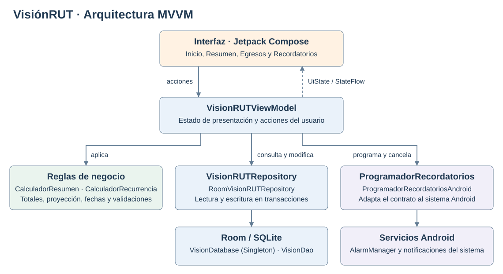
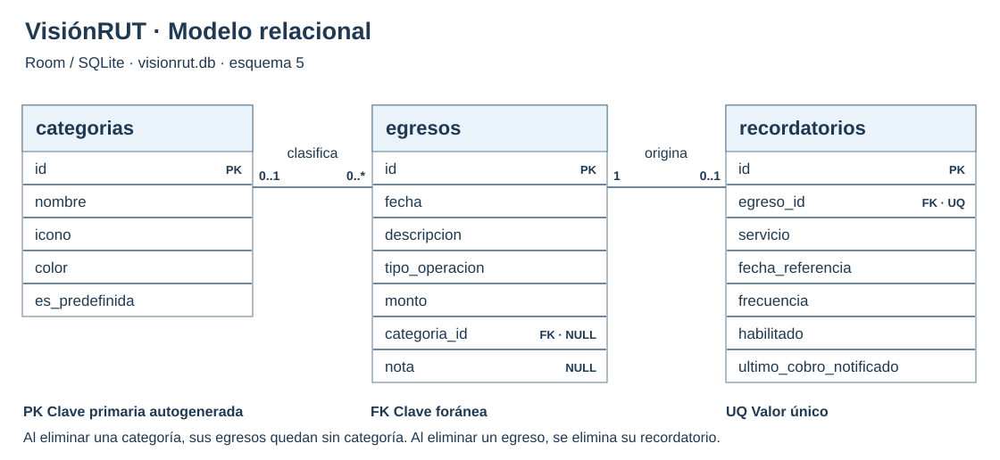

# VisiónRUT

Aplicación académica Android para reconocer y organizar egresos de CuentaRUT. Una glosa como `MERPAGO*RAMONDIAZ` identifica el cargo en la cartola. Su categoría y una nota personal permiten recordar qué se compró. El prototipo utiliza movimientos simulados y funciona localmente. La pantalla de inicio ilustra una posible entrada desde BancoEstado.

## Abrir y ejecutar en otro computador

1. Inicia sesión en GitHub con una cuenta que tenga acceso al repositorio privado. En Android Studio elige **Get from VCS** o **Clone Repository** y pega `https://github.com/Estxbvn1/VisionRUT.git`. También puedes elegir **Code → Download ZIP** en GitHub y descomprimir el archivo en una carpeta de trabajo.
2. Si descargaste el ZIP, elige **Open** en Android Studio y selecciona la carpeta que contiene `settings.gradle.kts`, `gradlew` y `app/`. Puede llamarse `VisionRUT-main`.
3. Usa Android Studio compatible con AGP 9.2.1 (por ejemplo, Quail 2). En **SDK Manager** instala **Android SDK Platform 36** y acepta las licencias solicitadas. El proyecto usa JDK 21 para Gradle. Si Studio pide un JDK, selecciona uno de esa versión en la configuración de Gradle.
4. Deja terminar **Gradle Sync**. La primera sincronización necesita internet para descargar Gradle y las dependencias. Studio usa la ubicación de tu propio SDK. El repositorio incluye el Gradle Wrapper.
5. En **Device Manager**, inicia un emulador con Android 8.0 (API 26) o superior. También puedes conectar un teléfono con depuración USB habilitada y autorizar el computador. Elige el dispositivo, selecciona **app** y pulsa **Run ▶**.
6. Abre **VisionRUT** desde la pantalla bancaria simulada. La primera apertura prepara la cartola local. En Android 13 o superior, concede el permiso de notificaciones si quieres demostrar avisos.

Un ZIP contiene el código fuente. Clonar conserva además el historial de Git y permite recibir cambios con `git pull`. Una *Release* puede identificar una entrega y ofrecer un APK para instalar en un teléfono. Es opcional para abrir y compilar el proyecto.

## Funciones y alcance

- **Resumen** muestra total, cantidad, pendientes y distribución por categoría del mes elegido. Desde ahí se accede a los egresos filtrados y a la proyección.
- **Egresos** permite consultar la glosa original, filtrar, asignar o quitar una categoría individualmente o en grupo y guardar una nota opcional de hasta 40 caracteres Unicode. Reclasificar conserva el monto del movimiento.
- **Categorías** permite crear categorías personales con nombre, icono y color, y eliminarlas. Las ocho categorías incorporadas están protegidas y «Sin categoría» es un nombre reservado. Al eliminar una propia se conservan los movimientos y sus notas.
- **Recordatorios** permite crear, editar, activar y eliminar avisos mensuales o anuales vinculados a un cobro de Suscripciones. El aviso programado apunta a las 09:00 locales del día anterior. Android puede aplazar la entrega. La campana de un recordatorio activo permite demostrar el aviso de ese servicio sin adelantar el siguiente cobro.
- **Proyección** estima el mes siguiente por categoría. Usa el mes consultado y hasta dos anteriores con datos. Si el mes está en curso, estima su cierre en proporción a los días transcurridos. Incluye los egresos sin categoría y reparte el redondeo al peso para que el desglose sume el total. Requiere movimientos en el mes consultado.

La muestra cubre agosto a noviembre de 2026 y usa pesos chilenos. Se cargan los movimientos hasta la fecha del dispositivo. Antes de agosto de 2026 la cartola está vacía y después de noviembre la consulta inicial se sitúa en noviembre. La aplicación no solicita credenciales bancarias ni se conecta a servicios del banco. Los recordatorios tampoco efectúan pagos ni cancelaciones.

## Estructura y arquitectura



El código del módulo está en [cl/visionrut/app](app/src/main/java/cl/visionrut/app). Los paquetes `ui`, `viewmodel`, `domain`, `data` y `notifications` corresponden a los componentes del diagrama. La interfaz observa el estado según su ciclo de vida. Los contratos del repositorio y del programador permiten probar el ViewModel con implementaciones de prueba.

## Base de datos



La base se almacena en el espacio privado de la aplicación. Room conserva [los esquemas de las versiones 1 a 5](app/schemas/cl.visionrut.app.data.VisionDatabase) para documentar sus migraciones. Una referencia de categoría nula representa «Sin categoría».

Al **reclasificar** una suscripción con aviso, el usuario debe confirmar. El repositorio elimina el recordatorio junto con la reasignación en una transacción y el ViewModel solicita cancelar la alarma correspondiente.

Los montos son enteros en CLP. Las fechas de negocio son días desde el 1 de enero de 1970 (`LocalDate.toEpochDay()`). Esto conserva el día civil al guardar y leer sin convertir una fecha de compra en una hora UTC. Para programar la alarma sí se combina la víspera con una hora y la zona local. `ultimo_cobro_notificado` guarda el día del **vencimiento** cuyo aviso se entregó. El valor inicial es `-1`. Permite identificar el ciclo ya atendido al restaurar las alarmas y conservar la fecha de cobro visible.

Para inspeccionar datos, ejecuta **app** en un emulador API 26+ y abre **View → Tool Windows → App Inspection → Database Inspector**. Selecciona el proceso `cl.visionrut.app`, expande `visionrut.db` y abre una tabla. Para leer fechas en una consulta utiliza `date('1970-01-01', fecha || ' days')` en la tabla `egresos`.

## Entorno y dependencias

| Componente | Configuración del proyecto |
| --- | --- |
| Android | min SDK 26, compile y target SDK 36 |
| Compilación | Android Gradle Plugin 9.2.1, Gradle Wrapper 9.4.1, JDK del daemon 21, compatibilidad Java 17 |
| Kotlin y Compose | Kotlin integrado en AGP, plugin de compilación Compose 2.2.10, Compose BOM 2026.02.01, UI 1.10.4, Material 3 1.4.0 |
| Persistencia y estado | Room 2.8.4, KSP 2.3.6, Lifecycle 2.10.0, corrutinas Android 1.9.0 |
| Pruebas | JUnit 4.13.2, coroutines-test, AndroidJUnitRunner, Compose UI Test y Espresso 3.7.0 |

## Compilación y pruebas

Desde la raíz del proyecto en PowerShell:

```powershell
.\gradlew.bat :app:assembleDebug
.\gradlew.bat :app:testDebugUnitTest
.\gradlew.bat :app:connectedDebugAndroidTest
```

En macOS o Linux usa `./gradlew` en lugar de `.\gradlew.bat`. Si PowerShell indica que no encuentra Java, configura `JAVA_HOME` para la sesión. Por ejemplo, si Android Studio está instalado en su ruta habitual y su JBR es JDK 21:

```powershell
$env:JAVA_HOME = "$env:ProgramFiles\Android\Android Studio\jbr"
```

Las **26 pruebas locales** ejercitan reglas de negocio, proyección y redondeo, filtros, notas Unicode, recurrencias, navegación y acciones del ViewModel. En Android Studio abre `app/src/test/java/cl/visionrut/app/` en la vista **Project**. Puedes ejecutar una clase desde el triángulo junto a su nombre. El informe de Gradle queda en `app/build/reports/tests/testDebugUnitTest/index.html`.

Las **9 pruebas instrumentadas** ejercitan Room y migraciones (4), navegación y gestos (3), un recorrido funcional (1) y entrega de notificación al invocar el receptor (1). Para ejecutarlas, inicia un emulador con la fecha dentro o después de la muestra; para reproducir la cartola completa usa diciembre de 2026 o posterior. Ejecuta el comando `connectedDebugAndroidTest` con el emulador disponible. La puntualidad real de los avisos bajo ahorro de batería requiere una comprobación en el teléfono de destino.

Los archivos de configuración del SDK, las credenciales y los productos generados se excluyen de Git. La licencia Apache 2.0 de los archivos de fuente Roboto distribuidos con la aplicación se incluye en `licenses/Roboto.txt`.
